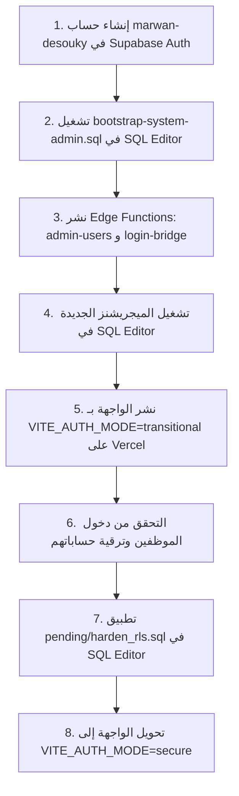

# تقرير حالة المشروع: التعديلات المنفذة والمهام المتبقية
**المشروع:** `warehouse-ledger`  
**الفرع الحالي:** `fix/auth-rls-purchase-rpc`  
**التاريخ:** 14 أكتوبر 2026  
**حالة الاختبارات والبيانات:** ✅ نجاح 223 من أصل 223 اختباراً (تطابق تام للبيانات بنسبة 100%)

---

## أولاً: التعديلات التي تم تنفيذها بالكامل داخل الكود والمستودع

تم إنجاز كافة متطلبات التحصين والمعالجة في مستودع المشروع ومحلياً وفق قواعد عدم فقدان البيانات:

### 1. تحصين حساب السيستم أدمن الثابت (`marwan-desouky`)
- ✅ **حظر الحذف والتعديل في قاعدة البيانات:**
  إنشاء الهجرة [`supabase/migrations/20261014120000_protected_system_admin.sql`](file:///c:/Users/Glory/warehouse-ledger/supabase/migrations/20261014120000_protected_system_admin.sql) مع Triggers قبلية تمنع أي حذف أو تعديل للبيانات الحساسة حتى لو صدر الأمر من `service_role`.
- ✅ **حظر الحذف والترقية في وظيفة السيرفر (`admin-users`):**
  تعديل الدالة لرفض حذف أو تعديل أو ترقية أي مستخدم آخر لدور `system_admin`، واستبعاد حساب `marwan-desouky` من قائمة المستخدمين.
- ✅ **الحماية من انتحال الاسم (Anti-Homoglyph):**
  إنشاء مكتبة [`src/lib/protectedAccounts.ts`](file:///c:/Users/Glory/warehouse-ledger/src/lib/protectedAccounts.ts) بتطبيع NFKC وتجريد الحروف المخفية والمتشابهة بالكامل.
- ✅ **إخفاء الحساب من الواجهة:**
  تعديل `UsersPage.tsx` لحجب صف الحساب والعدادات وعمليات التصدير عن أي مستخدم آخر.

### 2. معالجة خطر قفل الدخول (Zero Lockout) وجسر الدخول الآمن
- ✅ **دعم الوضع الانتقالي (`transitional`):**
  تعديل `src/lib/authMode.ts` لدعم وضع `transitional` الافتراضي الذي يسمح بالدخول دون قفل.
- ✅ **إلغاء فحص الباسورد بالمتصفح:**
  حذف استعلام `app_users` بمفتاح `anon` ومقارنة الباسورد داخل المتصفح من `AuthPage.tsx` نهائياً.
- ✅ **Edge Function جديدة (`login-bridge`):**
  إنشاء دالة [`supabase/functions/login-bridge/index.ts`](file:///c:/Users/Glory/warehouse-ledger/supabase/functions/login-bridge/index.ts) التي تعمل بمقارنة زمنية ثابتة مع جدول مكافحة التخمين [`20261014120001_login_attempts.sql`](file:///c:/Users/Glory/warehouse-ledger/supabase/migrations/20261014120001_login_attempts.sql) (5 محاولات فاشلة لكل 15 دقيقة)، مع استبعاد حساب السيستم أدمن منها.
- ✅ **تجريد الباسوردات من التخزين المحلي:**
  تعديل `src/lib/localUsers.ts` لتفريغ الباسورد دائماً عند الحفظ في `localStorage`.

### 3. دليل وسكريبت تهيئة السيستم أدمن بدون أي أسرار
- ✅ **دليل التهيئة الآمن:**
  إنشاء [`scripts/bootstrap-system-admin.md`](file:///c:/Users/Glory/warehouse-ledger/scripts/bootstrap-system-admin.md) بالخطوات التفصيلية بدون أي كلمات مرور.
- ✅ **سكريبت SQL التكراري والآمن:**
  إنشاء [`scripts/bootstrap-system-admin.sql`](file:///c:/Users/Glory/warehouse-ledger/scripts/bootstrap-system-admin.sql) لضبط الصلاحيات `raw_app_meta_data` وربط الحساب بجدول `app_users` دون لمس أي عمود آخر.

### 4. تصحيح دالة تسجيل المشتريات `record_purchase` وربطها بالواجهة
- ✅ **توثيق المخطط الفعلي:**
  كتابة ملخص تفصيلي ودقيق لكافة الجداول والقيود في [`docs/DATA_MODEL.md`](file:///c:/Users/Glory/warehouse-ledger/docs/DATA_MODEL.md).
- ✅ **تصحيح دالة RPC السحابية:**
  إنشاء الهجرة [`supabase/migrations/20261014130000_fix_record_purchase_rpc.sql`](file:///c:/Users/Glory/warehouse-ledger/supabase/migrations/20261014130000_fix_record_purchase_rpc.sql) باستخدام معرفات UUID الحقيقية، وعمود التاريخ الصحيح `received_on`، وقفل صف `FOR UPDATE` لمنع التزامن، واستخراج الكاتب من الـ JWT، ومنع التكرار بـ `ON CONFLICT DO NOTHING`.
- ✅ **ربط الواجهة ومنع الزيادة المزدوجة:**
  تعديل مسارات الشراء والاستيراد في `src/App.tsx` لاستدعاء الـ RPC وإعادة تحميل عهدة المخازن من السحابة، مع الإبقاء على سلامة مسار الأوفلاين.
- ✅ **حماية العهدة من المسح بالنسخ القديمة:**
  ترقية `saveCustodyItemsToCloud` في `src/lib/custody.ts` لتفحص السحابة وتمنع استبدال رصيد المخزن الرئيسي الأعلى برصيد محلي أقل.

### 5. عزل سياسات RLS المشددة وإصلاح ثغراتها
- ✅ **عزل الملف في مجلد الانتظار:**
  نقل الملف عبر `git mv` إلى [`supabase/pending/20261013213000_harden_rls.sql`](file:///c:/Users/Glory/warehouse-ledger/supabase/pending/20261013213000_harden_rls.sql) مع كتابة دليل شروط النقل في [`supabase/pending/README.md`](file:///c:/Users/Glory/warehouse-ledger/supabase/pending/README.md).
- ✅ **منع تزوير هوية المدقق في السيرفر:**
  إضافة Trigger قبلي `set_audit_log_actor` يفرض بيانات المستخدم من الـ JWT في السيرفر، وتعديل `src/lib/auditLogger.ts` لعدم إرسال بريد وهمي.
- ✅ **حجب الباسورد وإخفاء الحساب المحمي في RLS:**
  تعديل سياسة القراءة لإخفاء صف السيستم أدمن وسحب صلاحية قراءة عمود الباسورد `REVOKE SELECT (password)` وتوفير View آمن `safe_app_users`.
- ✅ **ضبط نطاق قراءة المشتريات:**
  تمكين موظف المشتريات من قراءة كافة فواتير الشراء المؤسسية القديمة والحديثة ومنع قراءة أي منصرف.

### 6. تنظيف التوثيق وفحوصات السرية
- ✅ **تحديث وثائق الأمان:**
  إعادة كتابة [`docs/SECURITY_FINDINGS.md`](file:///c:/Users/Glory/warehouse-ledger/docs/SECURITY_FINDINGS.md)، وتحديث خطة الإطلاق في [`docs/MIGRATION_NOTES.md`](file:///c:/Users/Glory/warehouse-ledger/docs/MIGRATION_NOTES.md)، وسجل القرارات في [`docs/DECISIONS.md`](file:///c:/Users/Glory/warehouse-ledger/docs/DECISIONS.md).
- ✅ **أرشفة المستندات التاريخية:**
  وضع إشعار أرشيفي واضح في أول سطر لملفات `FINAL_REPORT.md` و`EXECUTION_LOG.md`.
- ✅ **التحقق من السرية:**
  التأكد من خلو `src/` ومتغيرات `VITE_*` من أي مفاتيح `service_role`، والتأكد من عدم تتبع ملفات `.env*` و`dist/` و`.vercel/` في Git.

---

## ثانياً: ما تبقى تنفيذه (الخطوات العملية اليدوية على Supabase وVercel)

هذه الخطوات تتطلب الوصول لحسابك على Supabase وVercel، ويجب تنفيذها بالترتيب التالي:



### 1. تجهيز حساب السيستم أدمن في لوحة Supabase
1. افتح **[Supabase Dashboard](https://supabase.com/dashboard)** لمشروعك.
2. انتقل إلى **Authentication** -> **Users** -> اضغط **Add user** -> **Create user**.
3. اكتب البريد: `marwan-desouky@warehouse.local`
4. اكتب كلمة مرور قوية جداً تختارها بنفسك.
5. تأكد من تفعيل خيار **Auto Confirm User** واضغط حفظ.

### 2. تشغيل استعلام ضبط الصلاحيات والربط
1. من القائمة الجانبية في Supabase، افتح **SQL Editor**.
2. افتح ملف [`scripts/bootstrap-system-admin.sql`](file:///c:/Users/Glory/warehouse-ledger/scripts/bootstrap-system-admin.sql) من مشروعك.
3. انسخ محتواه والصقه في SQL Editor واضغط **RUN**.
4. ستظهر رسالة نجاح تؤكد تثبيت دور `system_admin` وربط المعرف.

### 3. نشر وظائف الحافة (Edge Functions)
من جهازك (أو من جهاز يحتوي على Supabase CLI ومربوط بمشروعك):
```bash
supabase functions deploy admin-users
supabase functions deploy login-bridge
```
*(وتأكد من وجود المتغير السري `SUPABASE_SERVICE_ROLE_KEY` في إعدادات Functions على Supabase).*

### 4. تطبيق الهجرات الجديدة المضافة
داخل **Supabase SQL Editor**، انسخ وشغّل محتوى الملفات الثلاثة الجديدة بالترتيب:
1. `supabase/migrations/20261014120000_protected_system_admin.sql` (تفعيل حماية حساب marwan-desouky).
2. `supabase/migrations/20261014120001_login_attempts.sql` (جدول مكافحة التخمين).
3. `supabase/migrations/20261014130000_fix_record_purchase_rpc.sql` (دالة الشراء الذرية الصحيحة).

### 5. نشر الواجهة بالوضع الانتقالي على Vercel
1. في لوحة تحكم **Vercel** -> اذهب إلى مشروع `warehouse-ledger` -> **Settings** -> **Environment Variables**.
2. تأكد من ضبط:
   ```env
   VITE_AUTH_MODE=transitional
   ```
3. ارفع الفرع الحالي `fix/auth-rls-purchase-rpc` وادمج تعديلاته للنشر على Vercel.

### 6. التحقق واكتمال دخول الموظفين
1. جرّب الدخول بحسابك كمدير نظام (`marwan-desouky`).
2. اطلب من الموظفين (أمين المخزن، موظف المشتريات) تسجيل الدخول لتقوم دالة `login-bridge` بإنشاء حسابات Auth لهم تلقائياً بسلاسة دون أن يشعروا بأي انقطاع.

### 7. تطبيق سياسات RLS المشددة (بعد تأكد دخول الجميع)
بعد أن يتم ترقية حسابات جميع الموظفين النشطين بنجاح:
1. افتح **Supabase SQL Editor**.
2. انسخ محتوى الملف المعلّق:
   [`supabase/pending/20261013213000_harden_rls.sql`](file:///c:/Users/Glory/warehouse-ledger/supabase/pending/20261013213000_harden_rls.sql)
3. الصقه واضغط **RUN** لقفل الجداول وتأمينها نهائياً.

### 8. التبديل إلى الوضع المشدد نهائياً (`secure`)
1. في Vercel، غيّر متغير البيئة إلى:
   ```env
   VITE_AUTH_MODE=secure
   ```
2. أعد النشر (Redeploy). الآن أصبح النظام يعمل بالمصادقة السحابية المشددة بنسبة 100%.

---

## 🔄 خطة التراجع الطارئ (في حال حدوث أي مفاجأة)
- **تراجع الواجهة:** من لوحة تحكم Vercel، اختر إعادة نشر النسخة الموسومة `pre-security-backup` بضغطة زر واحدة.
- **تراجع الـ RLS:** نفّذ ملف [`supabase/rollbacks/20261013213000_harden_rls_rollback.sql`](file:///c:/Users/Glory/warehouse-ledger/supabase/rollbacks/20261013213000_harden_rls_rollback.sql) في SQL Editor لإعادة السياسات المفتوحة فوراً.
